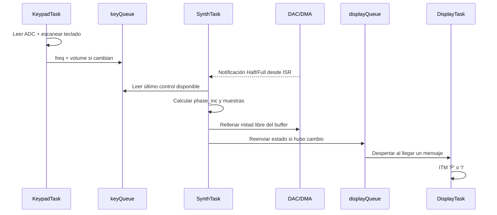

# Arquitectura del sistema

## 1. Vista general

El proyecto concentra la lógica de aplicación en `Core/Src/main.c` y utiliza CMSIS-RTOS v2 sobre FreeRTOS. El procesamiento se divide en tres tareas con prioridades diferentes y dos colas de mensajes. La producción continua de audio se apoya en un DMA circular y notificaciones directas desde ISR.



## 2. Flujo de entrada

### Teclado matricial 4×4

- Filas: `PD0` a `PD3`, configuradas como salida.
- Columnas: `PD4` a `PD7`, entradas con `GPIO_PULLUP`.
- El escaneo activa una fila en nivel bajo y revisa las cuatro columnas.
- La primera tecla detectada define la frecuencia.
- La matriz `note_frequencies[4][4]` contiene 16 frecuencias entre 262 Hz y 622 Hz.

### Potenciómetro

- Entrada: `PA1 / ADC1_IN1`.
- Resolución: 12 bits.
- Conversión a volumen:

```text
volume = ADC × 100 / 4095
```

`KeypadTask` solo envía un mensaje si cambia la frecuencia o si el volumen cambia más de 2 puntos porcentuales. Esto reduce tráfico innecesario en la cola.

## 3. Flujo de síntesis

`SynthTask` es la tarea de mayor prioridad porque debe atender a tiempo el rellenado del búfer que consume el DAC.

### Frecuencia de muestreo

La configuración observada es:

- SYSCLK = 168 MHz.
- APB1 = 42 MHz.
- Clock de temporizadores APB1 = 84 MHz.
- TIM6 prescaler = 0.
- TIM6 period = 2624.

Por tanto:

```text
Fs = 84 MHz / (2624 + 1) = 32 kHz
```

### DDS

La LUT senoidal tiene 256 muestras. Se emplea un acumulador de fase de 16 bits:

```text
phase_inc = (freq × 65536) / 32000
LUT_index = phase_acc >> 8
```

La salida de la LUT se centra alrededor de 2048 y se escala con el volumen antes de escribirse al búfer de 12 bits.

### Doble mitad del búfer

El búfer contiene 128 muestras. DMA opera en modo circular. Cuando se termina de reproducir cada mitad, HAL ejecuta una callback:

- `HAL_DAC_ConvHalfCpltCallbackCh1()` → notifica valor `1`.
- `HAL_DAC_ConvCpltCallbackCh1()` → notifica valor `2`.

`SynthTask` se bloquea en `xTaskNotifyWait(..., portMAX_DELAY)` y no consume CPU mientras espera. Al recibir la notificación rellena solo la mitad que ya quedó libre.

Una mitad son 64 muestras:

```text
64 / 32000 = 0.002 s = 2 ms
```

Por ello la tarea de síntesis recibe trabajo aproximadamente cada 2 ms durante la reproducción continua del DMA.

## 4. Tareas y prioridades

| Tarea | Prioridad | Motivo técnico | Activación |
|---|---|---|---|
| `SynthTask` | Alta | Un retraso puede provocar que DMA alcance datos no renovados y afectar el audio. | Notificación desde ISR del DMA. |
| `KeypadTask` | Normal | La interacción humana tolera decenas de milisegundos sin impacto apreciable. | Ciclo periódico de ≈20 ms. |
| `DisplayTask` | Baja | La indicación de estado no es crítica para mantener la generación de audio. | Bloqueada en `displayQueue`. |

La configuración cumple tres niveles distintos de prioridad, pero el reto exige al menos cuatro tareas de aplicación y el firmware actual contiene tres.

## 5. Comunicación entre tareas

### `keyQueue`

- Productor: `KeypadTask`.
- Consumidor: `SynthTask`.
- Longitud: 16.
- Tamaño de elemento: 4 bytes.
- Dato: `ControlMsg_t` con frecuencia y volumen.

### `displayQueue`

- Productor: `SynthTask`.
- Consumidor: `DisplayTask`.
- Longitud: 8.
- Tamaño de elemento: 4 bytes.
- Dato: `ControlMsg_t`.

### Notificación directa

- Productor: ISR asociada al DMA del DAC.
- Consumidor: `SynthTask`.
- Valores: `1` para mitad inicial y `2` para mitad final.
- Motivo: baja sobrecarga y activación inmediata de una única tarea.

## 6. Planificación y preempción

FreeRTOS está configurado con `configUSE_PREEMPTION = 1`. Cuando DMA termina una mitad del búfer:

1. se ejecuta la callback en contexto de interrupción;
2. `xTaskNotifyFromISR()` pone `SynthTask` en estado **Ready** si estaba bloqueada;
3. `portYIELD_FROM_ISR()` solicita cambio de contexto cuando corresponde;
4. al ser `SynthTask` de prioridad alta, puede ejecutarse antes de una tarea de prioridad normal o baja;
5. al terminar de rellenar la mitad, vuelve a bloquearse esperando la siguiente notificación.

Estados relevantes:

- **Running:** tarea que está usando CPU en ese instante.
- **Ready:** tarea lista para ejecutarse, a la espera del scheduler.
- **Blocked:** tarea esperando un retardo, mensaje o notificación; no consume CPU.

La arquitectura soporta un caso real de preempción, pero el repositorio no incluye una traza temporal que demuestre visualmente la secuencia. `docs/PRUEBAS.md` propone cómo obtener esa evidencia durante la demostración.

## 7. Recursos compartidos

No se observa un recurso de software accedido simultáneamente por varias tareas que requiera mutex:

- ADC y teclado: usados por `KeypadTask`.
- generación y escritura del búfer: `SynthTask`.
- consumo del búfer: DMA de hardware, sincronizado por eventos Half/Full.
- salida ITM: usada por `DisplayTask` en la lógica de aplicación.

Si en el futuro varias tareas escriben a una misma pantalla I²C o comparten el bus con otros dispositivos, deberá revisarse la necesidad de un mutex.

## 8. Limitaciones arquitectónicas observadas

- Solo hay tres tareas de aplicación.
- No existe una máquina de estados explícita en el código.
- I²C está inicializado, pero no hay driver ni llamadas HAL I²C de aplicación para una pantalla.
- No hay comprobación explícita del resultado de `osMessageQueuePut()`.
- `HAL_ADC_PollForConversion()` se usa con timeout de 10 ms; no se evalúa su valor de retorno antes de leer el ADC.
- La suficiencia real de las pilas no está demostrada mediante mediciones de *high-water mark* en el repositorio.
