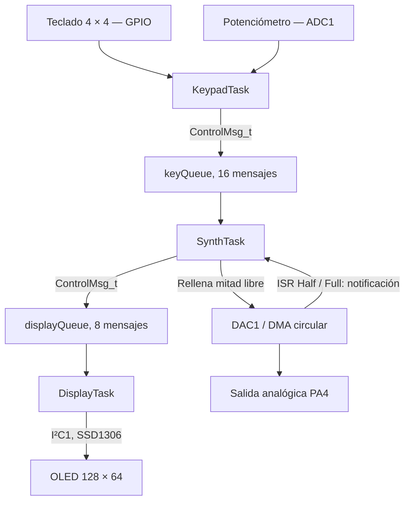
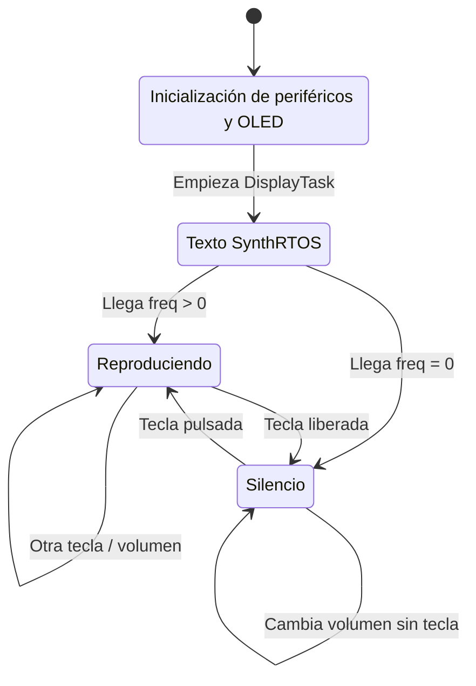

# Arquitectura de software y FreeRTOS

## 1. Organización general

La lógica de aplicación se encuentra en `Core/Src/main.c`. El firmware utiliza HAL STM32F4, CMSIS-RTOS v2 sobre FreeRTOS, un sintetizador por **DDS** (síntesis digital directa), DMA circular para el DAC y una pantalla OLED atendida mediante **I²C1**. El driver y sus fuentes están en `Core/Src/ssd1306.c`, `Core/Src/ssd1306_fonts.c` y `Core/Inc/ssd1306*.h`.



La salida DAC y la OLED tienen responsabilidades distintas: generación de sonido e información visual al usuario.

## 2. Datos de control y comunicación

En `main.c` se define:

```c
typedef struct {
    uint16_t freq;
    uint8_t volume;
} ControlMsg_t;
```

La aserción del código comprueba que su tamaño total sea **4 bytes**. Los mensajes transportan una frecuencia en Hz y un porcentaje de volumen. Dos colas creadas con CMSIS-RTOS v2 los distribuyen:

| Mecanismo | Origen → destino | Capacidad | Dato o evento | Motivo |
|---|---|---:|---|---|
| `keyQueue` | `KeypadTask` → `SynthTask` | 16 × 4 B | `ControlMsg_t` | Separar adquisición de entrada y generación de sonido. |
| `displayQueue` | `SynthTask` → `DisplayTask` | 8 × 4 B | `ControlMsg_t` | Actualizar la OLED solo cuando hay cambios consumidos por el sintetizador. |
| `xTaskNotifyFromISR` | Callback DMA → `SynthTask` | 1 valor de notificación | `1` para primera mitad, `2` para segunda | Despertar rápidamente al productor de muestras. |

`SynthTask` consume **como máximo un elemento** de `keyQueue` por notificación de DMA (`osMessageQueueGet(..., timeout=0)`). `DisplayTask` se bloquea esperando `displayQueue` mediante `osMessageQueueGet(..., portMAX_DELAY)`. El uso de colas es funcional, aunque los `osMessageQueuePut()` no comprueban su estado devuelto.

## 3. Tareas, prioridad, frecuencia y memoria

| Tarea | Prioridad CMSIS | Stack configurado | Ejecución | Recursos usados |
|---|---|---:|---|---|
| `SynthTask` | `osPriorityHigh` | `512 × 4 = 2048 B` | Evento de DMA cada 64 muestras (≈2 ms) | Buffer global `audio_buffer`, DAC, `keyQueue`, `displayQueue` |
| `KeypadTask` | `osPriorityNormal` | `256 × 4 = 1024 B` | `osDelay(20)`, más el tiempo de lectura y escaneo | ADC1, GPIO puerto D, `keyQueue` |
| `DisplayTask` | `osPriorityLow` | `512 × 4 = 2048 B` | Evento al llegar un mensaje | I²C1, búfer de pantalla SSD1306, `displayQueue` |

**Justificación:** la síntesis es la más urgente, pues un retraso al rellenar DMA puede degradar el audio; la interfaz humana admite tiempos de respuesta moderados; la actualización de la pantalla es menos crítica y se atiende cuando hay un mensaje. `configUSE_PREEMPTION=1`, `configTICK_RATE_HZ=1000` y `configTOTAL_HEAP_SIZE=32768` aparecen en `FreeRTOSConfig.h`.

**Pilas:** se documenta su tamaño configurado, no una validación empírica. Falta una medición con *high-water mark* o método equivalente para justificar su suficiencia en ejecución real.

**Requisito pendiente:** el reto solicita **cuatro o más tareas de aplicación**. El código crea únicamente estas **tres**; las tareas internas de FreeRTOS no se cuentan.

## 4. Entradas y procesamiento

### Teclado 4 × 4

`PD0–PD3` son salidas (filas); `PD4–PD7` son entradas con pull-up (columnas). El programa baja una fila por vez, busca una columna activa en nivel bajo y selecciona la **primera tecla** encontrada. La tabla `note_frequencies[4][4]` contiene 16 notas (262 a 622 Hz). Si no hay tecla pulsada, la frecuencia calculada es cero.

### Potenciómetro

`PA1` corresponde a `ADC1_IN1`, con resolución de 12 bits. El porcentaje entero se calcula como:

```text
volume = (ADC_raw × 100) / 4095
```

El mensaje se envía cuando cambia la frecuencia o la diferencia absoluta respecto al volumen anterior supera **2 puntos porcentuales**. El código llama `HAL_ADC_PollForConversion(..., 10)` sin verificar su retorno.

## 5. Síntesis y temporización DAC

El temporizador **TIM6** tiene reloj de 84 MHz, prescaler `0`, periodo `2624` y salida `TRGO Update`:

```text
Fs = 84 000 000 / [(0 + 1) × (2624 + 1)] = 32 000 muestras/s
```

Una tabla `sine_lut` de 256 valores (12 bits) se indexa con un acumulador de fase de 16 bits:

```text
phase_inc = (freq × 65536) / 32000
indice_lut = phase_acc >> 8
muestra_dac = 2048 + ((sine_lut[indice_lut] - 2048) × volumen) / 100
```

Cuando `freq=0`, `phase_inc=0`, la muestra se establece en `2048` y la fase se reinicia. `HAL_TIM_Base_Start()` y `HAL_DAC_Start_DMA()` inician la salida desde `SynthTask`.

El búfer `audio_buffer` tiene **128 muestras de 16 bits**. DMA1 Stream5/Channel7 opera en modo circular y dispara callbacks a mitad y al final de la transferencia. Cada mitad contiene 64 muestras:

```text
Tiempo por mitad = 64 / 32000 = 0,002 s = 2 ms
```

- `HAL_DAC_ConvHalfCpltCallbackCh1()` notifica valor `1`: rellenar `audio_buffer[0..63]`.
- `HAL_DAC_ConvCpltCallbackCh1()` notifica valor `2`: rellenar `audio_buffer[64..127]`.
- La espera se hace con `xTaskNotifyWait(..., portMAX_DELAY)`, sin una espera activa.

Las notificaciones emplean `eSetValueWithOverwrite`: un evento nuevo **puede reemplazar uno previo no atendido**. No existe contador de eventos perdidos en el código.

## 6. Pantalla OLED: último cambio incorporado

El código ya **utiliza** el controlador SSD1306 (no se limita a configurar I²C):

- Antes del scheduler: `ssd1306_Init()`, limpieza y texto `Prueba OLED`.
- Al comenzar `DisplayTask`: texto de bienvenida `SynthRTOS`.
- Ante una frecuencia mayor que cero: `Nota:`, nombre devuelto por `ObtenerNombreNota()`, `Freq: ... Hz` y `Vol: ... %`.
- Ante un mensaje con frecuencia cero: `Silencio...`.

Las operaciones de pantalla usan `ssd1306_Fill`, `ssd1306_SetCursor`, `ssd1306_WriteString` y `ssd1306_UpdateScreen`. La biblioteca ejecuta llamadas HAL I²C bloqueantes con `HAL_MAX_DELAY`, y **no verifica** el resultado devuelto por ellas. No se usa una tarea adicional ni un mutex para la OLED: la inicialización ocurre antes del scheduler, y luego la actualiza `DisplayTask`.

## 7. Estados observables y transiciones



