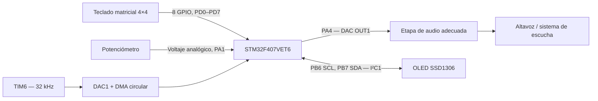

# Hardware, periféricos y conexiones

Los pines y configuraciones de esta página se extrajeron de `Generador_sonidos.ioc`, `Core/Src/main.c`, `Core/Src/stm32f4xx_hal_msp.c` y `Core/Inc/ssd1306_conf.h`. La referencia exacta del teclado, potenciómetro, etapa de audio y módulo OLED físico no está documentada en el ZIP.

## 1. Diagrama funcional de bloques

## 2. Tarjeta y periféricos STM32

- MCU objetivo: **STM32F407VET6** (`STM32F407VETx` en el `.ioc`); paquete LQFP100.
- Frecuencia SYSCLK: **168 MHz** (fuente HSE + PLL en el código).
- APB1: **42 MHz**; reloj de temporizador APB1: **84 MHz**.
- Temporización de HAL: **TIM7**; planificación de FreeRTOS: tick de **1 ms**.
- Firmware package declarado por `.ioc`: **STM32Cube FW_F4 V1.28.3**.

## 3. Tabla de pines

| Elemento | Pin STM32 | Interfaz / configuración | Función |
|---|---|---|---|
| Potenciómetro (terminal central / señal) | `PA1` | `ADC1_IN1`, analógica | Leer nivel de volumen. |
| Teclado, fila 1 | `PD0` | GPIO push-pull, salida | Seleccionar fila 1. |
| Teclado, fila 2 | `PD1` | GPIO push-pull, salida | Seleccionar fila 2. |
| Teclado, fila 3 | `PD2` | GPIO push-pull, salida | Seleccionar fila 3. |
| Teclado, fila 4 | `PD3` | GPIO push-pull, salida | Seleccionar fila 4. |
| Teclado, columna 1 | `PD4` | GPIO entrada con pull-up | Leer tecla en columna 1. |
| Teclado, columna 2 | `PD5` | GPIO entrada con pull-up | Leer tecla en columna 2. |
| Teclado, columna 3 | `PD6` | GPIO entrada con pull-up | Leer tecla en columna 3. |
| Teclado, columna 4 | `PD7` | GPIO entrada con pull-up | Leer tecla en columna 4. |
| Audio analógico | `PA4` | `DAC_OUT1` / TIM6 TRGO / DMA1 | Entregar onda sintetizada a una etapa externa apropiada. |
| OLED SCL | `PB6` | `I2C1_SCL`, alternate function, open-drain | Reloj I²C. |
| OLED SDA | `PB7` | `I2C1_SDA`, alternate function, open-drain | Datos I²C. |
| Programación y depuración | `PA13`, `PA14` | SWDIO, SWCLK | ST-LINK o compatible. |
| Traza (configurada) | `PB3` | SWO | Depuración; el firmware actual no envía trazas ITM de aplicación. |

## 4. Entradas físicas

### Teclado 4 × 4 (GPIO)

Las cuatro filas se inicializan en alto. En cada escaneo se baja una fila a cero y se leen las columnas `PD4–PD7` con pull-up. El teclado suministra la frecuencia seleccionada. La primera tecla encontrada determina la nota (sin soporte de acordes). Los rebotes se mitigan de forma básica mediante `osDelay(20)`; no hay un filtro de rebote por tecla adicional.

### Potenciómetro (ADC1)

- Canal: `ADC1_IN1` en `PA1`.
- Resolución y alineación: 12 bits, derecha.
- Disparo: software, una conversión regular, no continuo.
- Tiempo de muestreo: 3 ciclos ADC.
- Escala de aplicación: `0–4095 → 0–100 %`.

## 5. Salida física 1: audio analógico por DAC

| Recurso | Valor configurado |
|---|---|
| DAC | Canal 1, `PA4`, trigger `TIM6 TRGO`, buffer de salida habilitado |
| TIM6 | Prescaler 0, periodo 2624, `TRGO Update` |
| Frecuencia de muestreo | **32 kHz** |
| DMA | `DMA1 Stream5`, `Channel7`, memoria → periférico, modo circular, half-word |
| Buffer | 128 muestras de 16 bits, divididas en dos mitades de 64 |

## 6. Salida física 2: OLED SSD1306 por I²C

| Parámetro | Configuración encontrada |
|---|---|
| Controlador previsto | SSD1306 |
| Interfaz | `I2C1`, Fast Mode, 400 kHz |
| Pines | `PB6` = SCL, `PB7` = SDA |
| Dirección de 7 bits | `0x3C` (en HAL se pasa `0x3C << 1`) |
| Resolución esperada por el driver | `128 × 64` píxeles |
| Orientación configurada | `SSD1306_MIRROR_VERT` y `SSD1306_MIRROR_HORIZ` |
| Fuente empleada en pantalla | `Font_11x18` y `Font_7x10` |

El archivo `ssd1306_conf.h` selecciona la familia STM32F4 y el transporte I²C. El controlador realiza `HAL_I2C_Mem_Write()` con registros de control `0x00` (comandos) y `0x40` (datos).

**Salidas visibles previstas:** `Prueba OLED` durante la inicialización, `SynthRTOS` en la bienvenida y, ante mensajes, nota, frecuencia y volumen o `Silencio...`. Estas son funciones implementadas en el firmware, pero deben comprobarse con la pantalla real. Si el módulo incorpora pull-ups I²C, verificar su tensión; `PB6/PB7` no activan pull-up interno en el MSP.

## 7. Configuración y procedimiento de prueba por periférico

| Módulo | Qué verificar en el montaje |
|---|---|
| Teclado | Cada una de las 16 teclas produce la nota de la matriz; una tecla liberada deja `freq=0`. |
| ADC / potenciómetro | Girar el control y verificar cambios en `Vol: ... %` y amplitud de audio. |
| DAC + TIM6 + DMA | Escuchar o medir la salida de `PA4` a través de una etapa apropiada; comprobar cambio de frecuencia y amplitud. |
| OLED / I²C | Confirmar alimentación y dirección; verificar la secuencia inicial y valores mostrados en reproducción. |
| FreeRTOS / DMA | Confirmar que las interrupciones Half/Full generan notificaciones y la tarea `SynthTask` rellena ambas mitades. |
